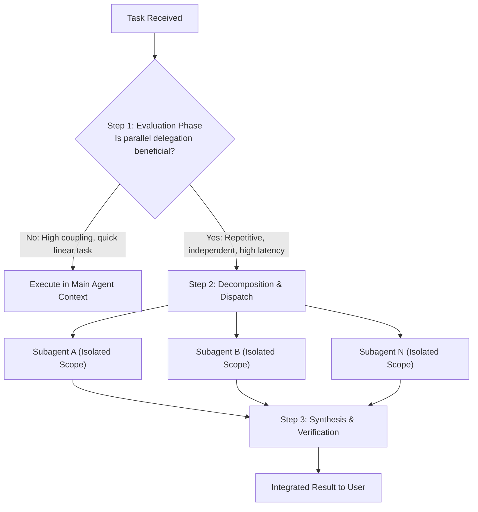

# Subagent Parallelism & Delegation Skill

## Purpose
When executing complex engineering tasks, linear execution can bottleneck development and clutter context. This skill governs **intelligent workload parallelism**: deciding *if* subagent delegation is warranted, decomposing tasks into non-conflicting units, dispatching subagents in parallel, and aggregating their findings.

---

## The 3-Step Delegation Lifecycle

---

## Step 1: Evaluation Phase (The Gatekeeper)

Before launching subagents, evaluate against the **Parallelism Matrix**:

| Criterion | Parallel Subagents Favored | Main Agent Linear Favored |
| :--- | :--- | :--- |
| **Task Independence** | Completely decoupled files/domains | Shared mutable state / single file |
| **Volume / Repetition** | $\ge 3$ distinct modules, audits, or tests | 1–2 simple edits or sequential logic |
| **Context Footprint** | Heavy file reads, large logs, deep audits | Focused, localized edits |
| **Overhead vs Speed** | Tasks take significant time concurrently | Orchestration overhead exceeds task time |

### Evaluation Rule
* If the task is sequential or involves editing the same file: **DO NOT DELEGATE**.
* If the task can be split into 2+ completely independent units (e.g., documenting 4 separate hardware modules, auditing 3 independent services, running multiple independent benchmarks): **DELEGATE**.

---

## Step 2: Task Decomposition & Dispatch

When delegation is approved:
1. **Define Clean Boundaries**:
   * Assign distinct target directories or non-overlapping file lists to each subagent to eliminate write conflicts.
2. **Standardize the Prompt Contract**:
   Each subagent must receive:
   * **Role**: Specific job title (e.g. `"Hardware Pinout Auditor"`, `"Component Doc Generator"`).
   * **Context**: Direct paths to the exact files to read.
   * **Deliverable**: Exact files to create/edit and the required schema.
3. **Dispatch Subagents**:
   Launch concurrently using `invoke_subagent`.

---

## Step 3: Synthesis & Verification

1. **Reactive Await**: Let subagents complete asynchronously without busy polling.
2. **Review Deliverables**:
   * Inspect generated files or diffs for contract adherence.
   * Check for syntax validity and style consistency.
3. **Run Global Verification**:
   * Execute project linters, unit tests, or build commands.
4. **Report Back to User**: Provide a single unified summary of all parallel actions taken.

---

## Reusable Template
Use `.agents/skills/subagent-parallelism/templates/TASK_DECOMPOSITION_TEMPLATE.md` to format delegation briefs.
